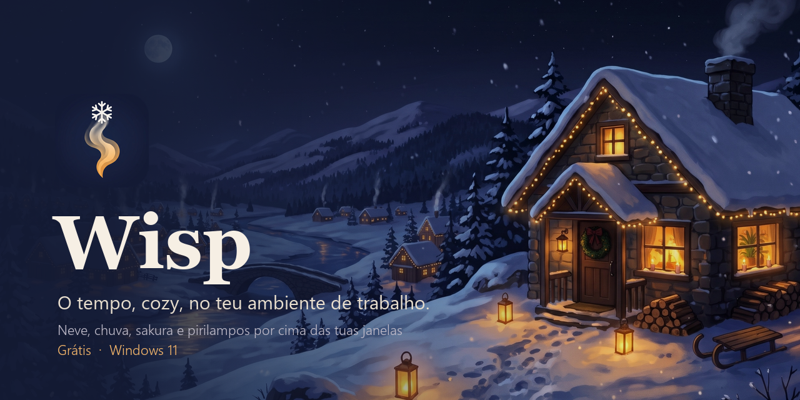
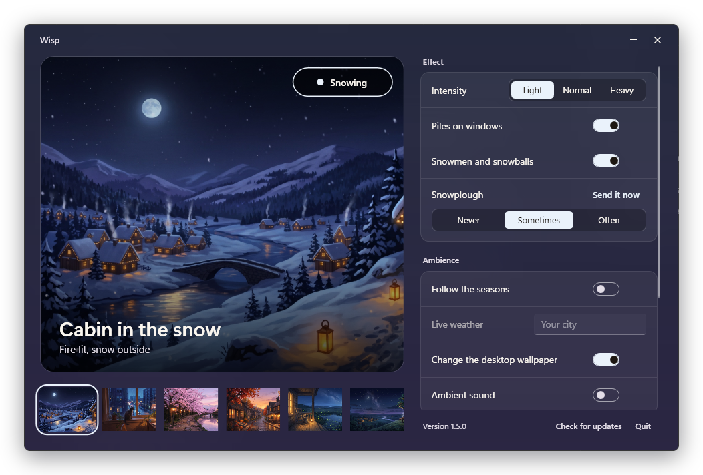
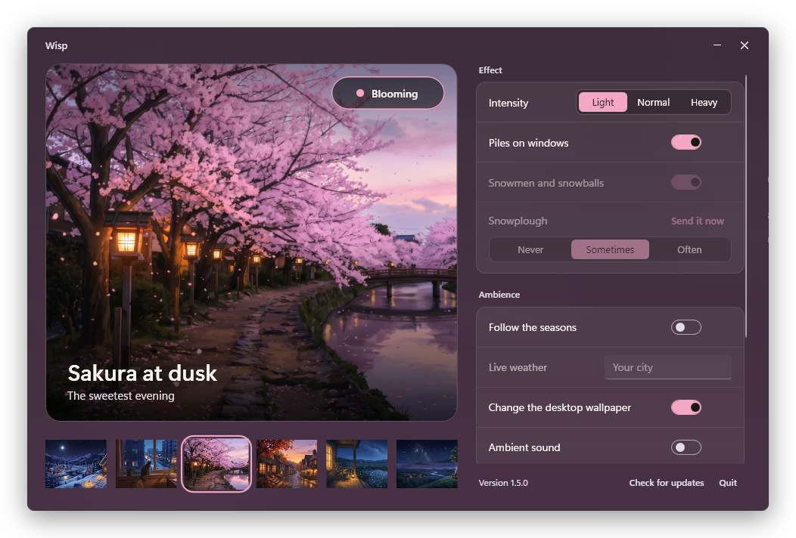
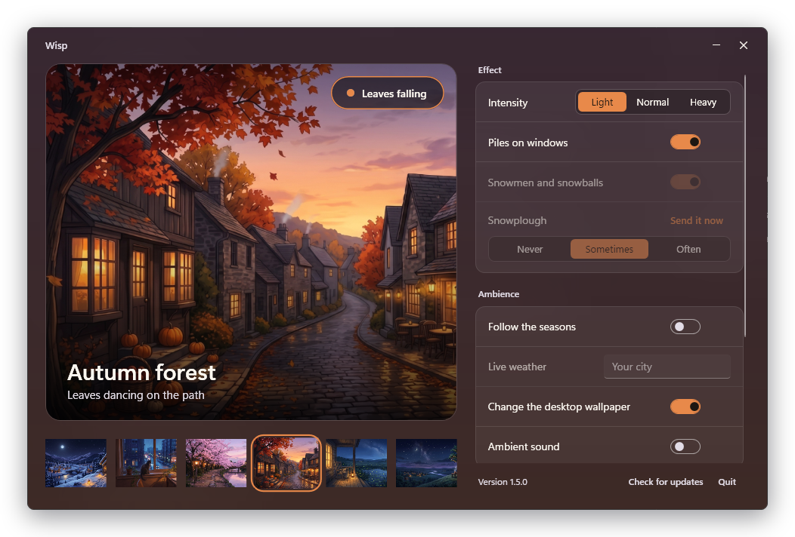
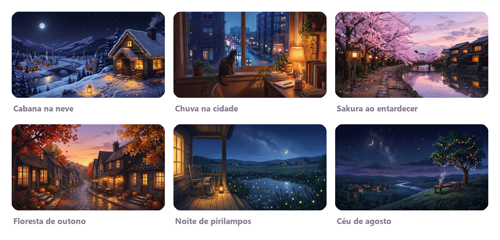

  

  
  
  

  <b>Wisp turns your desktop into a quiet window on the weather.</b> 
  Snow settles on top of your windows, rain streaks past, sakura petals drift by and fireflies glow over the wallpaper, 
  each with its own hand-painted scene, colours and soft ambient sound.

 

  

## ✨ What it does

**🌨️ Weather that lives on your desktop**
- Six effects, each with its own hand-painted scene: snow, rain, sakura, autumn leaves, fireflies and shooting stars.
- Snow lands on top of your windows and piles up on the taskbar. Drag a window and the snow slides into an overhang; shake it and clumps break off.
- When a heap gets too tall it slumps and levels out, the way real snow does.
- Wisp can follow the seasons and the time of day on its own. It can also switch to snow or rain when it is actually snowing or raining in your city.

**⛄ Play in the snow**
- Hold <kbd>Alt</kbd> and drag along the snow to roll a snowball. It picks up snow as it rolls, and grows faster the faster you roll it.
- Let go to set it down. Stack three to build a snowman.
- Build two or more snowmen and they come alive: they waddle about and throw snowballs at each other.
- A little snowplough clears the taskbar now and then, or whenever you send it.

**🕯️ Made to be cozy**
- Every scene comes with a matching wallpaper, and the whole app takes on that scene's colours.
- Optional ambient sound for each scene: a crackling fire, rain heard from indoors, soft birdsong and summer crickets. The sound gets quieter when something else is playing.
- A glass window that lets your desktop show through, with everything set up in one place.

**🍃 Light on your PC**
- Pauses over fullscreen apps and games, and over maximized windows if you want.
- Lowers its frame rate on battery and when nothing is moving, and stops completely while the PC is locked.
- Hidden from screenshots and screen sharing by default, so it never ends up in your meetings.
- Updates quietly in the background and asks for nothing.

 

  
  

The whole app takes on the colours of the scene you pick.

## 🖼️ Scenes

  

| Scene | Effect | Sound |
|---|---|---|
| Cabin in the snow | Snow that piles up on your windows | Crackling fire |
| City rain | Rain on the glass, now and then a soft flash of lightning | Rain heard from indoors |
| Sakura at dusk | Drifting cherry blossom petals | Distant birdsong |
| Autumn forest | Falling leaves | Crackling fire |
| Firefly night | Fireflies glowing over the wallpaper | Crickets |
| August sky | Shooting stars | Crickets |

## 📥 Install

1. Download **`Wisp-Setup-x.y.z.exe`** from the [latest release](https://github.com/goncalooliveira03/Wisp-releases/releases/latest).
2. Run it. It installs just for you, in a few seconds, without asking for admin rights.
3. Wisp opens straight away. Close the window and it carries on quietly in the tray; click the tray icon to open it again.

> [!NOTE]
> Wisp is a free app from an independent developer and is not code-signed yet, so Windows may show **"Windows protected your PC"** the first time.
> Click **More info**, then **Run anyway**. Each download can be checked against the `.sha256` file published with the release.

**Requirements:** Windows 11, 64-bit. The glass window needs Windows 11 22H2 or newer.

## 🎮 Little things to try

| Do this | And this happens |
|---|---|
| <kbd>Alt</kbd> + drag along the snow | Roll a snowball that picks up snow as it goes |
| Let go | Set the snowball down. Three stacked make a snowman |
| <kbd>Alt</kbd> + <kbd>Shift</kbd> as you let go | Throw it |
| Double-click a snowman | It crumbles back into snow |
| Shake a window | Knock the snow off its top |
| **Send it now**, in the app | Call the snowplough |

## 🔒 Privacy

Wisp has no account, no ads, no tracking and no analytics. It only goes online for two things:

- **Updates:** it checks this repository for a new version.
- **Live weather (optional, off by default):** if you type a city, its name is sent to [Open-Meteo](https://open-meteo.com) to look up the local weather.

Your settings stay on your PC, in `%LOCALAPPDATA%\DeskSnow`.

## ❓ FAQ

**Will it slow down my games?**
No. Wisp hides and pauses over fullscreen apps, and draws almost nothing when the screen isn't changing.

**Does it change my wallpaper?**
Only if you turn on *Change the desktop wallpaper*. Your own wallpaper is saved first and put back when you turn it off, quit or uninstall.

**Is it really free?**
Yes, free, with no ads and no catch.

**How do I uninstall it?**
Go to *Settings → Apps → Installed apps → Wisp → Uninstall*. Your wallpaper is restored.

## 💛 Credits

- **Scene art** generated by Gonçalo Oliveira with Google Gemini. The compositions and prompts are original.
- **Rain sound:** ["steady_rain_room_window_indoor"](https://freesound.org/s/510488/) by musicalmorsels, CC0. The fire, birds and crickets are generated by the app itself.
- **Weather data** by [Open-Meteo.com](https://open-meteo.com/), CC BY 4.0.

## 📄 License

Wisp is free to download and use. The app and its artwork are © 2026 Gonçalo Oliveira, all rights reserved. Please don't redistribute the app or the scene images.

 

Made in Portugal, for slow evenings ☕

